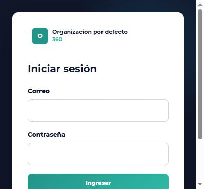

# 148. Bitácora del despliegue en el VPS

Registro paso a paso de la reinstalación de InfoMatt360 en el VPS: qué se
hizo, qué inconvenientes aparecieron y cómo se resolvieron. Sigue la guía
[docs/147](147_GUIA_INSTALACION_Y_ACTUALIZACION.md).

Pedido del responsable (2026-10-20):
- validar los dominios documentados y agregar el dominio y subdominio que
  falten;
- desinstalar las versiones de InfoMatt360 que haya en el VPS, el chatbot y
  n8n;
- instalar la versión nueva completa;
- documentar cada paso con capturas y los inconvenientes encontrados.

## Dominios documentados

| Dominio | Uso | Estado |
|---|---|---|
| `infomatt360.tecnomatt.com` | Plataforma (web, API, escritorio y app Expo) | Se conserva |
| `mobile-infomatt360.tecnomatt.com` | API móvil Express (retirada en el PR #49) | Sin uso tras la reinstalación |
| `mobile.infomatt360.tecnomatt.com` | APK del módulo Express retirado | Sin uso tras la reinstalación |

Pendiente: que el responsable indique el subdominio nuevo que se debe
agregar. docs/136 solo trae el dominio de ejemplo `app.infomatt360.com`; se
actualizará con los reales.

## Decisiones antes de borrar

- [x] Datos: se **conservan** (actualización con `infomatt360-upgrade.sh`).
- [x] Respaldo de n8n y Chatwoot antes de desinstalarlos (paso 4).
- [x] PR amopanta/infomatt360#52 y amopanta/infomatt360-mobile#2 unidos (paso 3).

## Pasos

### Paso 1 — Acceso al servidor (2026-10-20)

- **Resultado:** bloqueado.
- **Inconveniente 1:** el equipo de trabajo no tiene acceso SSH al VPS:
  `~/.ssh` no tiene llaves ni `config`, y `known_hosts` está vacío.
- **Solución propuesta:**
  1. Generar una llave en este equipo: `ssh-keygen -t ed25519 -C infomatt360-deploy`.
  2. Agregar la llave **pública** (`~/.ssh/id_ed25519.pub`) al usuario de
     despliegue del VPS: en `~/.ssh/authorized_keys`, o desde el panel del
     proveedor.
  3. Indicar la IP o el nombre del servidor y el usuario.

  La llave privada no sale de este equipo, y no se escriben contraseñas en
  la sesión.
- **Capturas:** no aplica; es una comprobación de terminal. Las pantallas
  del navegador se capturan desde el paso de instalación web.

### Paso 1b — Acceso con la llave existente (2026-10-20)

- El responsable entregó su llave PuTTY (`.ppk`). El equipo ya tenía la
  sesión guardada «servidor» (usuario `root`, puerto 22).
- **Inconveniente 2:** `puttygen` de Windows no acepta la conversión por
  línea de comandos (`-O private-openssh`); abrió una ventana de error.
  **Solución:** conversión local con un script de Python
  (`cryptography`), sin mostrar la llave. Se guardó como
  `~/.ssh/infomatt360_vps`, con permisos 600, y se creó el alias SSH
  `infomatt360-vps`.
- **Inconveniente 3 (seguridad):** la llave no tiene contraseña y su
  contenido quedó visible en la sesión de trabajo. **Acción recomendada al
  terminar:** generar una llave nueva, cargarla en el servidor y retirar
  esta de `authorized_keys`.
- **Resultado:** conexión correcta. Servidor Ubuntu 24.04.3 LTS, 4 núcleos,
  7,8 GB de RAM y 231 GB libres de 290 GB.

### Paso 2 — Inventario de solo lectura (2026-10-20)

**InfoMatt360:**

| Componente | Estado | Ubicación |
|---|---|---|
| Producción (9 contenedores) | En línea; commit `44f5795` del 17-oct, migración `0079`. Base de 25 MB: 16 usuarios y 10 registros | `/opt/infomatt360`, web en `127.0.0.1:18080` |
| QA (4 contenedores) | En línea, **creada el 20-oct a las 16:13**, con su propio `migraciones.log` | `/opt/infomatt360-qa-20261020-161345`, web en `127.0.0.1:18081` |
| API móvil Express (retirada) | **Sigue corriendo** como servicio `infomatt360-mobile`, puerto 3001 | `/opt/infomatt360-mobile` |
| Unos 25 contenedores de pruebas de septiembre | Detenidos | Restos |

**Otros sistemas en el mismo servidor (no son InfoMatt360):**

| Sistema | Dominio | Nota |
|---|---|---|
| n8n + Caddy | `chat.tecnomatt.com` (nginx → 5678), `n8.tecnomatt.org` | Puertos 5678, 8081 y 8444 abiertos a internet |
| Chatwoot | `crm.tecnomatt.org` (hay certificado) | **Su base de datos se reinicia en bucle**: falla al arrancar |
| `wt.tecnomatt.org` y `api-wt.tecnomatt.org` | Puertos 3636 y 8080 | Otro sistema, **no se toca** |
| aaPanel (BT Panel) | Administra nginx, MariaDB, PHP-FPM y FTP | Panel del servidor |
| MariaDB 3306 y PostgreSQL del sistema 5432 | **Expuestos a internet** (0.0.0.0) | Riesgo de seguridad; ver hallazgos |

**Dominios de InfoMatt360 en el servidor:**
- solo `infomatt360.tecnomatt.com`, con certificado Let's Encrypt, que
  apunta a `127.0.0.1:18080`;
- los dominios móviles documentados (`mobile-infomatt360…` y
  `mobile.infomatt360…`) **no tienen sitio en nginx**.

**Hallazgos de seguridad (no se cambian sin autorización):**
- MariaDB (3306), PostgreSQL del sistema (5432), n8n (5678) y FTP (21)
  escuchan en todas las interfaces;
- hay escritorio remoto (xrdp 3389).

Conviene cerrarlos en el firewall si no se usan desde fuera.

### Paso 3 — Decisiones del responsable y unión de la versión (2026-10-20)

- **Datos:** se **conservan**. Se actualiza la misma base, sin reinstalar
  desde cero.
- **Se desinstalan:**
  - Chatwoot y n8n con su Caddy;
  - la instalación QA del 20-oct;
  - la API móvil Express;
  - los contenedores de pruebas.
- **Versión:** se unieron amopanta/infomatt360#52 a `main` (commit
  `244b18e`) y amopanta/infomatt360-mobile#2 a `master` (`b373649`).
- **Pendiente:** cerrar sin unir los PR que quedaron incluidos (#51, #49,
  #48, #46 y mobile#1). Falta la autorización explícita del responsable.

### Paso 4 — Copias de seguridad (2026-10-20)

Se guardaron en el servidor en `/root/respaldos-20261020/`, con permisos 700
y 600 (5,6 MB), y en el equipo de trabajo en `D:\Claude\_respaldo_vps_20261020`
(18 archivos):

| Copia | Tamaño | Nota |
|---|---|---|
| Base de producción (`pg_dump`) | 320 KB | |
| Archivos subidos de producción | 351 B | La carpeta estaba prácticamente vacía |
| `.env.production` de producción | 3,5 KB | Contiene claves; no se sube a GitHub |
| Base y configuración de QA | 169 KB | |
| API móvil Express (código, base SQLite y servicio) | 4,6 MB | |
| n8n: volumen de datos (base SQLite con flujos y credenciales) y carpeta | 361 KB | |
| Chatwoot: volúmenes y carpeta | < 2 KB | |
| Configuración de nginx | 4,8 KB | |

- **Inconveniente 4:** `n8n export:workflow --all` no exportó ningún flujo:
  el archivo quedó en 146 B. Los flujos y credenciales quedan igual dentro
  del volumen respaldado (`vol-n8n-docker_n8n_data.tgz`, base
  `database.sqlite`). Para recuperarlos se restaura ese volumen en un n8n
  nuevo.
- **Inconveniente 5:** **Chatwoot nunca inicializó su base** (el volumen de
  Postgres estaba vacío); por eso se reiniciaba en bucle. No tenía datos.

### Paso 5 — Desinstalación (2026-10-20)

| Qué | Cómo | Resultado |
|---|---|---|
| InfoMatt360 QA | `docker compose down -v` y borrado de su carpeta | Retirada; puerto 18081 libre |
| 21 contenedores de pruebas detenidos | `docker rm` | Retirados |
| API móvil Express | `systemctl disable --now`, borrado del servicio y de `/opt/infomatt360-mobile` | Retirada; puerto 3001 libre |
| Chatwoot | `docker compose down -v` y borrado de su carpeta | Retirado |
| n8n + Caddy | `docker compose down -v`, borrado de `/root/n8n-docker`; se retiró `/etc/nginx/conf.d/n8n_redirect.conf` (`chat.tecnomatt.com`) | Retirados; puertos 5678, 8081 y 8444 libres |
| Imágenes sin uso | `docker image prune -af` | 576 MB liberados |

- `nginx -t` correcto y nginx recargado.
- No se tocaron `wt.tecnomatt.org`, `api-wt.tecnomatt.org`, aaPanel, MariaDB
  ni el PostgreSQL del sistema.

### Paso 6 — Actualización de InfoMatt360 (2026-10-20)

- **Inconveniente 6:** producción tenía
  `PERMISSIONS_POLICY=geolocation=(), microphone=(), camera=()`. Se cambió a
  `(self)`; el valor anterior quedó en la copia de seguridad.
- Se descargó `main` en `/opt/infomatt360` y se ejecutó
  `./scripts/infomatt360-upgrade.sh`. Log: `/root/upgrade-20261020.log`;
  copia propia del script: `backups/upgrade-20261020-211717`.
- Resultado: los 6 pasos sin errores. Se aplicaron las migraciones
  **0079 → 0080 … 0086** (8 migraciones). La base quedó en `0086_db_sync`
  (head).
- Datos conservados: **16 usuarios**. A 6 registros se les copió quién los
  capturó (los demás no tenían `submitted_by`).
- Servicios: 9 contenedores en línea (2 backends sanos, balanceador, web,
  workers, Postgres, Redis y PgBouncer). `/api/v1/health/ready` → `ready`.
- `/api/v1/install/status` → `installed: true`: el asistente no se reabre.
- Duración del corte: alrededor de 1 minuto. La construcción reutilizó
  capas en caché.

### Paso 7 — Verificación (2026-10-20)

- `https://infomatt360.tecnomatt.com/` responde 200 y muestra el inicio de
  sesión:

  

- **Inconveniente 7:** el inicio de sesión y las pruebas funcionales con una
  cuenta real (docs/147 §4) las debe hacer el responsable. El asistente de
  despliegue no escribe contraseñas de producción.
- **Inconveniente 8 (previo a esta versión):** las páginas web salen sin
  cabeceras de seguridad (`X-Frame-Options`, `Permissions-Policy`…). En
  `deploy/nginx.frontend.conf`, cada `location` con su propio `add_header`
  anula las del bloque `server`. No impide el uso (GPS y cámara no quedan
  bloqueados). Pendiente: repetir las cabeceras en cada `location` o usar un
  `include`.
- **Inconveniente 9:** el backend avisa «SMTP no configurado; la
  recuperación de contraseña no puede enviar correos». Hay que completar
  `SMTP_*` en `.env.production`, o configurar el correo desde la plataforma
  (docs/75).

## Dominios después del despliegue

| Dominio | Estado |
|---|---|
| `infomatt360.tecnomatt.com` | **En línea**, HTTPS con Let's Encrypt, web y API |
| `chat.tecnomatt.com` y `n8.tecnomatt.org` | Sin servicio (n8n retirado). Quitar o redirigir el registro DNS |
| `crm.tecnomatt.org` | Sin servicio (Chatwoot retirado). Quitar o redirigir el registro DNS. Su certificado sigue en el panel |
| `mobile-infomatt360.tecnomatt.com` | **En línea** (paso 8), con certificado propio y el mismo InfoMatt360 |
| `mobile.infomatt360.tecnomatt.com` | Sin DNS; su sitio en nginx se reemplazó en el paso 8 |
| `wt.tecnomatt.org` y `api-wt.tecnomatt.org` | Otro sistema; sin cambios |

Pendiente: el **subdominio nuevo** que pidió el responsable (nombre y para
qué).

## Pendientes después del despliegue

1. Prueba funcional con una cuenta real (docs/147 §4).
2. Configurar SMTP.
3. Corregir las cabeceras de seguridad del nginx de la web (inconveniente
   8).
4. Cerrar en el firewall MariaDB (3306), PostgreSQL del sistema (5432) y FTP
   (21), si no se usan desde fuera.
5. Rotar la llave SSH usada (inconveniente 3).
6. Limpiar en Hostinger los registros DNS de `chat.tecnomatt.com` (n8n retirado). `crm.tecnomatt.org` y `n8.tecnomatt.org` ya no tienen DNS.
7. Cerrar los PR incluidos.

### Paso 8 — Segundo dominio con su propio certificado (2026-10-23)

Los dominios se registran y su DNS se administra en **Hostinger**. Los
registros A de `infomatt360.tecnomatt.com` y `mobile-infomatt360.tecnomatt.com`
apuntan al VPS, así que el certificado que ve el visitante es el del VPS. El
«Lifetime SSL» del panel de Hostinger no se usa para estos dominios.

- **Inconveniente 10:** `mobile-infomatt360.tecnomatt.com` llegaba al VPS sin
  sitio propio. Mostraba el certificado de `infomatt360.tecnomatt.com`, y el
  navegador daba aviso de seguridad. Además, el sitio
  `mobile.infomatt360.tecnomatt.com`, que no tiene DNS, seguía apuntando a la
  API Express retirada.
- **Solución autorizada (opción 1):**
  1. Se reemplazó `/etc/nginx/sites-available/infomatt360-mobile` por la
     configuración de `mobile-infomatt360.tecnomatt.com`. Hay copias en
     `/root/respaldos-20261020/nginx-infomatt360-mobile.*`.
  2. Certificado Let's Encrypt propio, por webroot, igual que el principal.
     Vence el 21-ene-2027 y lo renueva el `certbot.timer` (activo).
  3. Mismo destino que el principal: `/api/` → `127.0.0.1:18000` y `/` →
     `127.0.0.1:18080`.
  4. `nginx -t` antes de cada recarga; la recarga no corta conexiones.
- **Verificación externa:**

| Dominio | Certificado | HTTP → HTTPS | Web | API |
|---|---|---|---|---|
| `infomatt360.tecnomatt.com` | válido, vence el 20-dic-2026 | 301 | InfoMatt360 | 200 |
| `mobile-infomatt360.tecnomatt.com` | válido (propio), vence el 21-ene-2027 | 301 | InfoMatt360 | 200 |

- No se tocaron los otros sistemas. `wt.tecnomatt.org` y
  `api-wt.tecnomatt.org` ya no respondían antes del cambio: **no tienen
  registro DNS**, y su configuración en aaPanel no la carga el nginx del
  sistema. Siguen sin cambios.
- **Inconveniente 11:** la prueba `certbot renew --dry-run` superó el tiempo
  de espera de la sesión. La configuración de renovación del certificado
  nuevo es igual a la del principal (webroot), que ya se renueva solo.
  Conviene revisar la renovación en diciembre, cuando le toque al
  principal.

### Paso 9 — Rediseño visual en producción (2026-10-23)

- Se unieron a `main` los PR #54 (rediseño, docs/150) y #53 (textos
  faltantes, docs/149), que iba incluido. Versión `3952f4a`.
- **Inconveniente 12:** mientras se preparaba el despliegue, el servidor dejó
  de responder ping, SSH y web durante unos 20 minutos. `last -x` muestra un
  arranque a las 15:43 sin apagado ordenado antes, es decir, un reinicio
  abrupto, no causado por InfoMatt360. Todos los contenedores volvieron solos
  y sanos (`restart: unless-stopped`). Si se repite, revisar en el panel del
  proveedor.
- Se ejecutó `./scripts/infomatt360-upgrade.sh`, con copia previa en
  `backups/upgrade-20261023-155305`. Migración sin cambios: sigue en
  `0086_db_sync`, porque esta versión no trae migraciones.
- **Verificación desde fuera:**
  - los dos dominios responden 200;
  - la hoja de estilos servida trae la letra nueva y las piezas de Inicio y
    Recorridos;
  - `GET /api/v1/field-devices/project/{id}/route-days` responde 401 (existe
    y pide sesión).
- El pendiente 7 (cerrar los PR incluidos) queda resuelto.

### Paso 10 — Segunda tanda del rediseño (2026-10-23)

- PR #55 unido a `main` (versión `5bda6a8`): menú en celular, Planeador,
  detalle de Registros, Participantes y Mapas (docs/150, sección 6).
- Se ejecutó `./scripts/infomatt360-upgrade.sh`, con copia previa en
  `backups/upgrade-20261023-210454`. Sin migraciones: sigue en
  `0086_db_sync`.
- **Verificación desde fuera:** los dos dominios responden 200, y la hoja de
  estilos servida trae el menú de celular, el encabezado de Registros y la
  página del Planeador.
